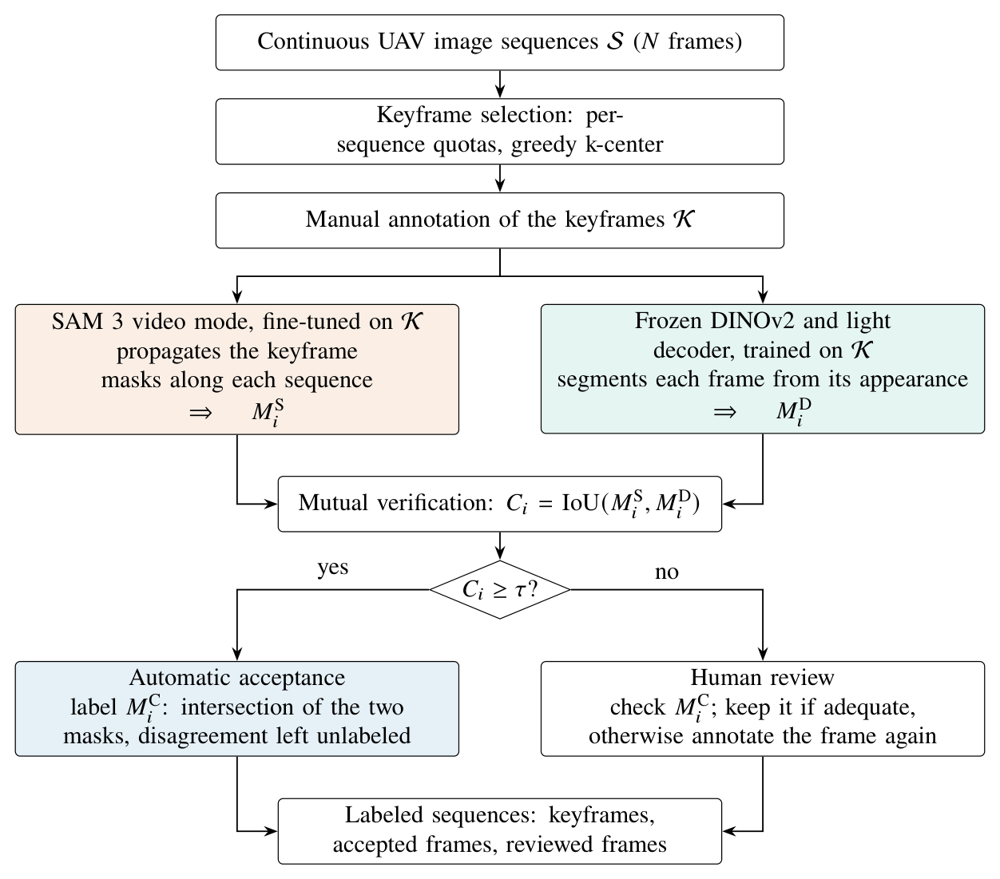
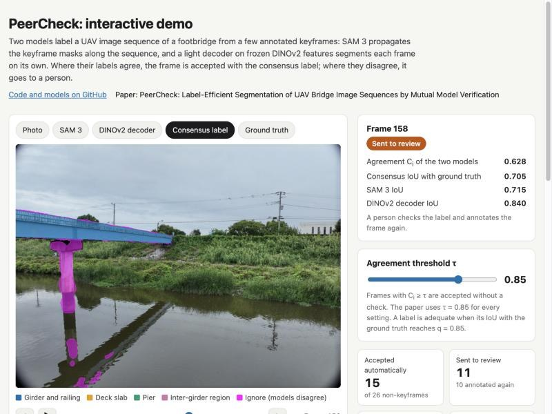

# PeerCheck

PeerCheck segments UAV bridge image sequences with sparse keyframe labels and
mutual verification between SAM 3 video propagation and a frozen DINOv2 encoder
with a trainable RGB-skip decoder.



Two peer models learn from the same few annotated keyframes. Frames on which
their labels agree are accepted with the consensus label; the other frames go
to a person for review.

## Online demo

**[Try it in the browser](https://xiezhengtao13-sys.github.io/PeerCheck/)**: play a
28-frame clip of the paper's footbridge, switch between the SAM 3, DINOv2 and
consensus labels and the ground truth, and move the agreement threshold to see
which frames are accepted, which go to review, and how much manual time the clip
needs. The page runs entirely in the browser on the saved predictions of the
paper; it is built from `demo/` by `scripts/build_web_demo.py` and served from
`docs/`.

[](https://xiezhengtao13-sys.github.io/PeerCheck/)

## Installation

Python 3.12 was used. The CPU demo needs no model downloads or GPU:

```bash
python -m venv .venv
# Activate the environment using your platform's usual command.
python -m pip install -r requirements.txt
python -m pip install -e .
python -m pytest
python demo/quick_demo.py --output quick_demo_output
```

The GPU environment uses PyTorch 2.10.0, torchvision 0.25.0, and CUDA 12.8:

```bash
python -m pip install torch==2.10.0 torchvision==0.25.0 --index-url https://download.pytorch.org/whl/cu128
python -m pip install -r requirements-gpu.txt
```

Install SAM 3 separately, **outside this repository**, and keep the exact commit
used in the experiments. Run these commands from the repository root:

```bash
git clone https://github.com/facebookresearch/sam3.git ../sam3
git -C ../sam3 checkout 46957e47805eaa273f4aa7bbbd25a88bca9108ce
git -C ../sam3 apply --check "$PWD/patches/sam3_compat.patch"
git -C ../sam3 apply "$PWD/patches/sam3_compat.patch"
python -m pip install --no-deps -e ../sam3
```

The compatibility patch provides optional-import and NMS fallbacks for systems
without working Triton. It does not change trained model parameters. See
[SAM 3's official instructions](https://github.com/facebookresearch/sam3/tree/46957e47805eaa273f4aa7bbbd25a88bca9108ce).
Request access to [the gated weights](https://huggingface.co/facebook/sam3),
authenticate locally, and download the official checkpoint into your own model
directory. Never commit credentials or checkpoints. DINOv2 downloads automatically
through Transformers at the revision pinned in `configs/paper.yaml`; an optional
`PEERCHECK_DINO_SOURCE` environment variable can point to a local model snapshot.

## Quick CPU demo

The included interval is the paper's sequence 3 (folder `sequence_011`), zero-based
frame indices **141-168**, with
two endpoint keyframes. The native paper results contain **15 accept and 11 review**
decisions among the 26 non-keyframes. The script reads only saved predictions,
recomputes their equal-label intersection, agreement, routing and GT metrics,
and writes `overview.jpg`, `metrics.csv`, and `summary.json` in a few seconds.
No model weights or training are involved.

`demo/paper_reference.csv` contains the corresponding native-resolution results.
Keyframe metric entries are blank because keyframes were excluded from paper
evaluation. The demo nevertheless reports their scores separately as keyframes.
In the clean environment it ran in **4.14 seconds**. Relative to native paper
metrics, maximum absolute differences were **0.000548 in agreement** and
**0.001208 in intersection foreground IoU**; no accept/review decision changed.

## Full GPU demo

```bash
python demo/full_demo.py --sam-checkpoint ../models/sam3.pt --output full_demo_output --work full_demo_work
```

This runs the whole pipeline on the demonstration clip from its two endpoint
keyframes: SAM 3 propagation from the pretrained checkpoint, training of a new
DINOv2 decoder (2000 steps), and mutual verification. It shows how the parts fit
together on a GPU. With two keyframes and no SAM 3 fine-tuning it does not
reproduce the paper's models, whose predictions the quick demo replays. Evaluation
GT is opened only after the predictions are complete. On an RTX 5090 the run took
about 6 min (14.5 s for SAM 3 and 340 s for the DINOv2 decoder) with a peak of
8.0 GiB of allocated GPU memory; allow at least 16 GB. Trained weights and
temporary features stay in the work directory.

## Run on your own sequences

Use this layout, with lexically sortable frame names and complete semantic masks:

```text
my_data/
  images/sequence_a/00000.jpg
  images/sequence_a/00001.jpg
  keyframes/sequence_a/00000.png
```

Class IDs: 0 environment, 1 girder and handrail, 2 deck, 3 pier, 4 inter-girder
structures/dark regions. Ignore 255 is an output label, not a training label.
Every sequence requires a keyframe; SAM fine-tuning requires at least one sequence
with two or more keyframes. All input frames in a sequence should share dimensions
and orientation. Annotate the EXIF-oriented RGB images.

```bash
python scripts/select_keyframes.py --input my_data --rho 5 --strategy uniform --output keyframes.csv
python scripts/select_keyframes.py --input my_data --rho 5 --strategy coverage-aware --output appearance_keyframes.csv
python scripts/run_peercheck.py --input my_data --sam-checkpoint ../models/sam3.pt --output output --work private_work
```

Create the selected masks before running the second stage. `run_peercheck.py`
fine-tunes SAM by default, trains the decoder, and writes `V3/`, `VD/`, `V8/`,
overlays, `decisions.csv`, `accept.csv`, and `review.csv`. Use `--sam-mode pretrained`
for the demonstration contract. All entry scripts support `--help`. Full model
execution requires CUDA; temporal keyframe selection and mutual verification do not.

## Paper settings and equations

| Equations | Module | Definition |
|---|---|---|
| 1-3 | `keyframes.py` | Nested proportional per-sequence quota; greedy k-center; temporal absolute distance or normalized DINOv2 CLS cosine distance |
| 4-6 | `sam3_propagation.py` | Four semantic objects; keyframe-only tracker fine-tuning; all prompts inserted before forward and reverse propagation |
| 7-8 | `dino_decoder.py` | Frozen ViT-L/14; RGB-skip decoder; weighted CE plus five-class soft Dice |
| 9-12 | `verification.py` | Pooled semantic foreground IoU, symmetric agreement, threshold routing, equal-label intersection |
| 13 | `effort.py` | Keyframes and re-annotated reviewed frames times 157 s, plus every reviewed frame times 7 s |

The configuration is `configs/paper.yaml`: ratios 1, 2, 3, 5, 7.5, 10, 15 and 20%,
two strategies, and seeds 0-2. Selection is nested; the two methods share initial
frames and per-sequence quotas within each seed. Temporal uniform means temporal
farthest-point selection, not a linspace sampler. Appearance selection uses
whole-image 518-square CLS embeddings, without GT.

SAM uses the official 1008-square tracker, frozen image backbone, 1000 optimizer
steps, sparse clips up to 8 keyframes, four objects, AdamW at 5e-6, cosine decay
to 0.1 of the initial rate, decay 0.1 excluding biases/LayerNorm, and gradient
norm clipping at 0.1. Loss weights are 20 focal, 1 Dice, 1 IoU regression and 1
object-presence loss. Only keyframes supply training targets and object presence.
The paper's results use SAM 3 checkpoints fine-tuned with these settings.

DINO input is 1344 by 1008 (bicubic, ImageNet-normalized); patch features are
1024 by 72 by 96. A 1x1 projection to 256 channels is followed by three 2x bilinear
upsampling blocks. Each concatenates resized raw RGB in [0,1] with its features,
then applies 259-to-256 3x3 convolution, BatchNorm and ReLU. A 1x1 five-class head
outputs 768 by 576 logits. There are 2,056,197 trainable parameters. Inference
upsamples float32 logits to the supplied image size before argmax. The confidence
is the mean, across **all pixels**, of the largest five-class softmax probability.
Training uses batch 4, AdamW at 1e-3, weight decay 0.01, 100-step warmup, cosine
decay, 2000 steps and no augmentation. CE weights are inverse-square-root class
frequencies in the selected keyframes, count floor one, normalized to mean one;
CE and soft Dice have equal coefficients. Only the final checkpoint is used.

Agreement and GT foreground IoU use the same **a_min=0.0005** rule: a map's entire
foreground is considered background for the metric if its area is positive and
strictly below that fraction of all pixels. This is not per-class deletion and
does not alter exported masks. Foreground IoU pools semantic class intersections
and unions, not a binary foreground silhouette. Both-empty foreground has score
one; ignore predictions retain GT false negatives. The intersection retains even
agreed background and sets every disagreement to 255. Accept uses C_i >= 0.85.
Keyframes are not auto-accepted evaluation cases. The quality cutoff q=0.85 is an
evaluation target, not a deployment calibration guarantee. The times of 157 s
to annotate a frame and 7 s to check one are means measured on the paper's dataset.

Paper comparisons used native 5280 by 3956 masks. The public demo is at one-quarter
linear resolution. Full dataset reproduction requires the private 659-frame
collection; it can be requested from the corresponding author. No fine-tuned SAM
or decoder weights are released because they were trained on that private data.
The optional YOLO comparator of the paper is documented in `baselines/yolo/`.

## Optional numeric results

`results/per_frame_metrics.csv.gz` contains the numeric and boolean columns of
the 31,632-row result table plus filename-only frame IDs. `strategy_code` is 0 for
uniform and 1 for coverage-aware. It contains no image pixels, masks, weights or local paths. Floating-point columns
are written with 15 significant digits to keep the compressed file below 20 MB;
the release audit verifies numerical agreement with the source table.

## Citation

```bibtex
@article{peercheck,
  title = {PeerCheck: Label-Efficient Segmentation of UAV Bridge Image Sequences by Mutual Model Verification},
  author = {Authors to be added},
  journal = {Journal to be added},
  year = {2026}
}
```

## License

Original PeerCheck code is MIT licensed. See `LICENSE`, `THIRD_PARTY_NOTICES.md`
and `demo/DATA_NOTICE.md` for the distinct third-party and data terms. The release
does not include SAM 3 source code or any pretrained/fine-tuned weights.
